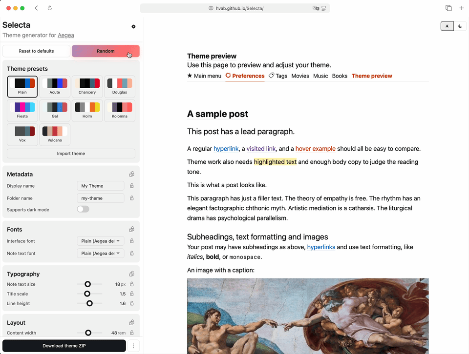

# Selecta

Selecta is a small browser-based theme generator for the [Aegea](https://blogengine.ru) blog engine.

The project is an experiment in making Aegea theme customization more visual and convenient: change theme settings, preview the result, and prepare theme files for further use.

## Preview



Selecta is a work-in-progress tool for creating and testing visual themes for Aegea. It runs in the browser and is deployed as a static site with GitHub Pages.

## Status

The latest documented release is `0.8.0`. Subsequent audit fixes are merged into `main` and listed under `Unreleased` in [`CHANGELOG.md`](./CHANGELOG.md).

The tool currently supports:

- Aegea `plain` child themes with editable metadata, light/dark palettes, typography, and layout;
- live English/Russian preview based on Aegea `11.5`, build `v4199`;
- Aegea presets, Random generation, field locks, and contrast hints;
- inherited fonts, system font stacks, and a curated Google Fonts catalog;
- local session restore, theme JSON import/export, and share links;
- ZIP export containing the theme folder, `theme-info.php`, and `styles/main.css`.

The app runs entirely in the browser. Google Fonts require network access. The interface, generated output, and internal structure may still change.

## Demo

[Open Selecta](https://hvab.github.io/Selecta/)

## Project documentation

- [`SPEC.md`](./SPEC.md): current product scope and theme contract.
- [`.project/PROGRESS.md`](./.project/PROGRESS.md): current status and next step.
- [`audit/README.md`](./audit/README.md): audit closeout, merged fixes, and remaining optional work.
- [`PREVIEW-BASELINE.md`](./PREVIEW-BASELINE.md): Aegea target, preview coverage, and acceptance limits.
- [`UI-ARCHITECTURE.md`](./UI-ARCHITECTURE.md): preview and editor responsibilities.
- [`RELEASE.md`](./RELEASE.md): checks and release workflow.

## Development

```bash
npm install
npm start
```

After startup, the project will be available at the local URL printed by Vite,
usually `http://localhost:5173/Selecta/`.

Build:

```bash
npm run build
```

Preview production build locally:

```bash
npm run preview
```

## Releases

Released changes are tracked in [`CHANGELOG.md`](./CHANGELOG.md).

## Project Flow

The `main` branch is used for active development and GitHub Pages deployment.

For changes, use short-lived branches:

```text
feature/theme-export
fix/pages-build
docs/readme
```

After merging into `main`, GitHub Actions builds the project and deploys it to GitHub Pages.

## License

MIT
